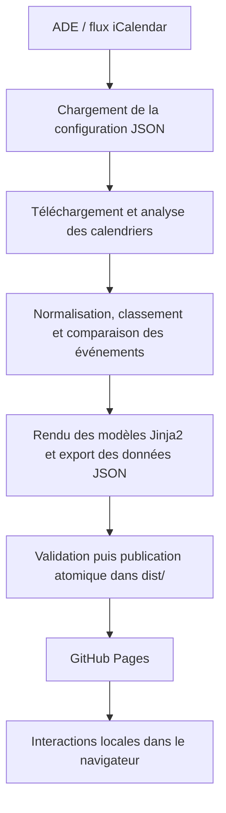
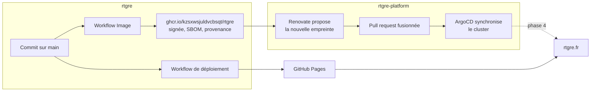

# RTGRE

[](https://github.com/kzsxwsjuldvcbsqt/rtgre/actions/workflows/quality.yml)
[](https://github.com/kzsxwsjuldvcbsqt/rtgre/actions/workflows/security.yml)
[](https://github.com/kzsxwsjuldvcbsqt/rtgre/actions/workflows/image.yml)
[](https://github.com/kzsxwsjuldvcbsqt/rtgre/actions/workflows/build.yml)
[](LICENSE)

Site étudiant qui regroupe l'emploi du temps, les évaluations, les modules, et un calcul de notes indicatif pour la troisième année du BUT Réseaux et Télécommunications de l'IUT1 de Grenoble.

Site en ligne : https://rtgre.fr

Projet étudiant non officiel. Il ne remplace pas ADE ni les informations communiquées par l'IUT. En cas de doute, ADE reste la référence.

## Sommaire

- [Pourquoi ce projet](#pourquoi-ce-projet)
- [Fonctionnalités](#fonctionnalités)
- [Architecture](#architecture)
- [Organisation du dépôt](#organisation-du-dépôt)
- [Technologies](#technologies)
- [Installation locale](#installation-locale)
- [Configuration](#configuration)
- [Tests et qualité](#tests-et-qualité)
- [Sécurité](#sécurité)
- [Déploiement](#déploiement)
- [Données personnelles et limites](#données-personnelles-et-limites)
- [Licence](#licence)

## Pourquoi ce projet

Pendant la formation, les informations utiles sont réparties entre plusieurs services : ADE pour l'emploi du temps, Chamilo pour les espaces des modules, la messagerie universitaire, les GitLab universitaires (IM2AG et GRICAD), l'OpenStack de l'IUT, et les informations sur les modules, les coefficients et les évaluations.

Cette répartition rend le suivi quotidien peu pratique. ADE permet de consulter un planning, mais il est difficile d'y rechercher un cours, de filtrer les évaluations ou de retrouver rapidement une information précise.

Ce projet rassemble ces usages sur un site unique, plus simple à consulter, adapté au contenu de cette formation. Le contenu actuel couvre les parcours Cybersécurité et DevCloud, la formation initiale et l'alternance, six groupes et les semestres 5 et 6 pour l'année configurée. Le code est paramétrable, mais il n'est pas pensé comme une plateforme générique pour d'autres établissements.

## Fonctionnalités

### Emploi du temps

L'emploi du temps est la première page de chaque classe ; l'ancienne adresse `calendar.html` redirige vers elle. Le calendrier est construit à partir des flux iCalendar d'ADE. Il propose une vue par jour, par semaine et une vue annuelle, ainsi que la navigation par date. Sur ordinateur, les vues jour et semaine s'affichent en grille horaire ou en liste ; la vue annuelle reste en liste. La recherche porte sur le cours, le module, la salle, l'enseignant ou le groupe.

Il permet aussi de filtrer les évaluations et de masquer les cours sans enseignant. Le cours en cours et l'heure actuelle sont indiqués. Les réglages de consultation sont conservés temporairement dans la session du navigateur.

### Évaluations

Le générateur repère certaines évaluations à partir de leur titre dans ADE. Les règles de reconnaissance sont définies dans `config/categories.json` et couvrent actuellement : DS surveillé, partiel machine, partiel, soutenance, oral noté, revue et une catégorie « surveillé par la scolarité ».

Les évaluations sont affichées par mois et peuvent être filtrées par catégorie, module et période, ou recherchées. Une page de détail donne l'ordre de passage des classes pour une même évaluation : les créneaux sont triés par heure, la classe consultée est mise en évidence, et les différences de date, de salle ou d'enseignant sont signalées sur chaque créneau.

Cette détection dépend des règles de configuration et des informations présentes dans ADE. Elle n'est pas infaillible : un titre inhabituel ou une donnée manquante peut fausser le résultat.

### Abonnement calendrier

Chaque classe publie deux calendriers au format iCalendar : tous ses cours (`calendrier.ics`) et ses évaluations seules (`evaluations.ics`). Les pages Emploi du temps et Évaluations ont un bouton « Ajouter à mon agenda » qui mène aux réglages, où l'on choisit pour chaque calendrier l'agenda de l'appareil, Google Agenda ou la copie du lien. Les titres y sont ceux du site, avec la catégorie devant le nom d'une évaluation, et les enseignants y sont désignés comme sur le site. Les noms de fichiers et la fréquence de rafraîchissement annoncée se règlent dans la section `feeds` de `config/site.json`.

### Modules et ressources

La page des modules regroupe les enseignements par semestre, type de module, parcours et statut de la classe. Elle construit les liens vers les espaces Chamilo correspondants lorsqu'ils sont disponibles. La navigation propose aussi des liens vers la messagerie étudiante, les GitLab IM2AG et GRICAD, et le compte OpenStack de l'IUT. Chaque module y indique son avancement (séances passées sur le total), sa prochaine séance et sa prochaine évaluation, avec un lien vers toutes ses séances dans l'emploi du temps et un lien vers son espace Chamilo. Ces repères restent justes entre deux mises à jour : la page contient les séances à venir et le navigateur écarte celles qui sont passées.

### Calcul des notes

Le site propose une saisie locale des notes. Les calculs s'appuient sur les coefficients décrits dans `config/curriculum.json` pour produire les moyennes par UE, par semestre, les synthèses annuelles et la moyenne annuelle globale. Les valeurs saisies sont enregistrées dans le stockage local du navigateur et peuvent être exportées ou importées au format JSON.

Pour les classes dont le détail est décrit dans la section `evaluation_details` de `config/curriculum.json`, un réglage « Détail des évaluations » permet de saisir chaque évaluation d'un module avec son coefficient ; la note du module devient alors la moyenne pondérée des évaluations saisies. Les notes de module saisies directement et les notes d'évaluations sont conservées séparément : activer ou désactiver le réglage ne supprime rien. L'export (format version 2) contient les deux jeux de notes et l'état du réglage ; l'import d'un fichier version 1 désactive le détail, et les notes d'évaluations d'une classe sans détail sont ignorées.

Le bouton « Relevé PDF » importe le relevé de notes provisoire édité par ScoDoc. Le fichier est lu entièrement dans le navigateur avec pdf.js, chargé uniquement à ce moment-là : il n'est envoyé nulle part et n'est pas conservé, seules les notes en sont extraites. Le relevé doit correspondre au parcours et au statut (formation initiale ou alternance) de la classe ouverte, sinon il est refusé. Les notes de module et les notes d'évaluations sont reprises, même si le détail des évaluations est désactivé ; les notes encore absentes du relevé (« ~ ») ne modifient rien. Une confirmation est demandée avant de remplacer une note déjà saisie qui diffère. Les repères de lecture du relevé sont réglables dans la section `grades.bulletin` de `config/site.json`.

Sous la synthèse, le site indique pour chaque UE entamée la moyenne qu'il reste à obtenir sur les notes manquantes pour atteindre la note de validation, ou signale qu'elle est déjà acquise ou hors d'atteinte.

Ces résultats ne sont pas des notes officielles. Ce sont des estimations basées sur les coefficients configurés et sur les valeurs saisies par l'utilisateur.

### Interface

L'interface reprend la structure d'une application web : une barre latérale fixe avec le choix de la classe, les pages et les liens utiles, une barre supérieure avec le fil d'Ariane et les actions de la page, et un contenu sur toute la largeur. Sur mobile et tablette, la barre latérale devient un menu qui s'ouvre depuis le bouton de la barre supérieure, et les filtres s'ouvrent dans une feuille en bas de l'écran. La page d'accueil guide le choix en deux étapes, formation puis classe ; la dernière classe consultée est mémorisée dans le navigateur, et l'adresse du site y ramène directement ensuite. Un mode sombre suit le réglage de l'appareil : il redéfinit les couleurs du site, sans feuille de style séparée. L'impression utilise un rendu clair adapté. Des raccourcis clavier changent de semaine, reviennent à aujourd'hui, réinitialisent les filtres et vont à la recherche ; chaque bouton annonce sa touche au survol et la page « À savoir » en donne la liste. La navigation reste utilisable au clavier, et les pages principalement informatives fonctionnent partiellement sans JavaScript. Les libellés et contrôles sont pensés pour l'accessibilité, sans que le projet revendique une conformité complète à une norme faute d'audit dédié.

### Thèmes

Le site peut changer d'habillage pour une période donnée, puis reprendre seul son apparence habituelle. Chaque thème tient dans son propre dossier, `static/themes/<identifiant>/`, avec une feuille `theme.css` et ses images. Un thème ne touche ni aux modèles HTML ni au JavaScript : il redéfinit des couleurs du site et ajoute quelques règles dans une couche CSS dédiée, placée au-dessus des styles habituels et sous ceux de l'impression.

Les thèmes sont déclarés dans `config/themes.json`. Chacun a un interrupteur `enabled`, une période, de `first_date` à `last_date` incluses, et la liste `preload_images` des images à charger en priorité. À chaque construction, le générateur retient le premier thème activé dont la période contient la date du jour ; sa feuille de style n'est chargée que dans ce cas, et les pages n'en portent aucune trace le reste du temps. La mise à jour automatique du site fait donc apparaître et disparaître un thème sans intervention.

| Thème | Ambiance |
| --- | --- |
| `vice` | coucher de soleil rose et violet sur la barre latérale, accent rose à la place du jaune |

D'autres thèmes sont prévus, dont un thème d'hiver. Pour en ajouter un :

1. créer `static/themes/<identifiant>/theme.css`, en s'appuyant sur les variables de `static/css/tokens.css` ;
2. ajouter son entrée dans `config/themes.json` avec sa période ;
3. lancer les tests, qui vérifient la configuration et la présence de la feuille de style.

Pour retirer un thème, il suffit de passer `enabled` à `false`, ou de supprimer son dossier et son entrée.

## Architecture

Le projet est un générateur de site statique. Il n'y a pas de serveur applicatif : la génération produit des fichiers HTML, CSS, JavaScript et JSON, puis tout le reste se passe dans le navigateur.



### Génération, en Python

Le pipeline se trouve dans `src/schedule/` :

- `build.py` orchestre la construction complète.
- `config.py` charge et valide les fichiers JSON.
- `fetcher.py` télécharge les calendriers ADE, avec un délai entre les requêtes, plusieurs tentatives et une validation minimale du contenu.
- `parser.py` analyse les documents iCalendar, normalise les dates, salles, enseignants et groupes, et produit les événements internes.
- `classifier.py` applique les règles de détection des évaluations.
- `matcher.py` rapproche les évaluations entre les groupes.
- `curriculum.py` prépare les modules, coefficients, ressources et données de notes.
- `viewmodels.py` prépare les données destinées aux vues.
- `renderer.py` génère les pages avec Jinja2 et y intègre le jeu d'icônes.
- `stylesheets.py` regroupe les feuilles de style du dossier `static/css/` en un seul fichier publié.
- `exporter.py` produit les fichiers JSON utilisés par le calendrier côté navigateur.
- `feeds.py` écrit les calendriers iCalendar auxquels on peut s'abonner.
- `sitecheck.py` vérifie les liens, les ressources, les fragments et les identifiants HTML du site généré.

La publication est protégée par plusieurs garde-fous : un verrou contre deux générations simultanées, une génération dans un dossier temporaire, une validation avant publication, un remplacement atomique de l'ancienne version, une restauration de la version précédente en cas d'échec et le refus d'écraser certains dossiers non gérés. Ces mesures limitent les mauvaises surprises lors des publications, sans constituer une garantie absolue.

Le chargement des pages est gardé léger sans outil de construction supplémentaire. Les styles restent découpés en fichiers par rôle dans le dépôt, mais le site publié n'en charge qu'un. Les icônes sont intégrées à chaque page au lieu d'être demandées séparément, ce qui les affiche dès le premier rendu. La police est hébergée avec le site et préchargée, si bien qu'aucune ressource ne vient d'un service tiers. Une page demande ainsi une quinzaine de fichiers au lieu de près de quarante.

### Navigateur, en JavaScript

Le dossier `static/js/` contient la logique exécutée dans le navigateur : le calendrier, les filtres des évaluations, le calcul des notes, l'import et l'export JSON, ainsi qu'un accès protégé aux données modifiables entre plusieurs onglets.

Le calendrier de la classe courante est intégré dans la page générée, sans requête supplémentaire. Les notes utilisent `localStorage` ; les filtres et réglages temporaires utilisent selon la page `sessionStorage` ou l'URL.

Il n'y a pas de serveur applicatif, pas d'API privée, pas de base de données, pas de système de compte ni d'authentification. Les notes ne sont pas envoyées vers un serveur.

## Organisation du dépôt

```
.
├── .github/
│   ├── workflows/       # intégration continue, analyses de sécurité et déploiement GitHub Pages
│   └── ISSUE_TEMPLATE/  # modèles d'issue : erreur, idée, tâche
├── config/              # données de l'année, classes, modules et règles
├── src/schedule/        # générateur Python
├── templates/           # modèles HTML Jinja2
├── static/
│   ├── css/             # styles
│   ├── js/              # logique exécutée dans le navigateur
│   ├── icons/           # icônes Phosphor
│   ├── fonts/           # police Inter, hébergée avec le site
│   ├── themes/          # thèmes temporaires, un dossier par thème
│   └── vendor/pdfjs/    # lecture des relevés PDF (pdf.js)
├── tests/
│   ├── python/
│   ├── javascript/
│   └── browser/
├── requirements.in      # dépendances Python directes du site
├── requirements.txt     # toutes les dépendances, compilées avec leurs empreintes (mise run lock)
├── requirements-dev.txt
├── Dockerfile           # image du générateur, publiée sur ghcr.io
├── .dockerignore
├── trivy.yaml           # configuration de Trivy, exceptions justifiées dans .trivyignore.yaml
├── package.json
├── pyproject.toml
├── mise.toml            # versions de Python, Node et des outils, tâches deps, check et build
├── renovate.json        # mises à jour automatiques des dépendances, des outils et des actions
├── .pre-commit-config.yaml
├── CONTRIBUTING.md      # façon de travailler, messages de commit, signature
└── SECURITY.md          # signalement privé des vulnérabilités
```

Le dossier `dist/` est généré par la construction et n'est pas suivi par Git.

## Technologies

- Python 3.14
- requests, icalendar, Jinja2
- HTML, CSS, JavaScript sans framework côté navigateur
- Node.js 26 pour les outils et les tests JavaScript
- mise pour fixer les versions, pre-commit pour les contrôles avant chaque commit
- unittest et node:test pour les tests
- Ruff et Prettier pour le formatage et les contrôles
- GitHub Actions et GitHub Pages
- Semgrep, Trivy, Gitleaks, zizmor et Renovate pour la sécurité

Node.js ne fait pas fonctionner le site en production. Il sert aux dépendances, aux contrôles et aux tests.

## Installation locale

Prérequis :

- [mise](https://mise.jdx.dev), qui installe Python, Node et les outils aux versions de `mise.toml`
- un accès réseau à ADE pour une génération réelle

Toutes les commandes se lancent depuis la racine du dépôt.

```bash
git clone https://github.com/kzsxwsjuldvcbsqt/rtgre.git
cd rtgre

mise install
mise run deps
pre-commit install
```

`mise run deps` crée l'environnement virtuel `.venv` et installe les dépendances Python et JavaScript. `pre-commit install` active les contrôles avant chaque commit.

Construction du site :

```bash
mise run build
```

Le résultat est placé dans `dist/`. Cette commande contacte ADE : elle peut échouer si le service est inaccessible ou si la configuration n'est plus valable.

Prévisualisation locale :

```bash
python -m http.server 8000 --directory dist
```

Puis ouvrir http://localhost:8000

Les tests navigateur complets, utilisés en intégration continue, demandent des outils supplémentaires : Chrome ou Chromium, et Firefox pour les vérifications multi-navigateurs.

## Configuration

Le comportement et le contenu du site sont décrits dans `config/`.

| Fichier | Rôle |
| --- | --- |
| `config/site.json` | identité du site, année, ADE, Chamilo, formats, enseignants et options générales |
| `config/classes.json` | formations, classes, parcours, statuts et identifiants de ressources ADE |
| `config/categories.json` | règles de reconnaissance des évaluations et marqueurs |
| `config/curriculum.json` | semestres, parcours, modules, UE et coefficients |
| `config/sections.json` | pages internes et liens externes affichés dans la navigation, avec un libellé court facultatif pour la barre d'onglets mobile |
| `config/calendar.json` | vues, jours affichés, affichage (grille horaire ou liste) et temporisations |
| `config/corrections.json` | retouches manuelles des cours ADE (suppression ou surcharge) |
| `config/labels.json` | textes affichés dans l'interface |
| `config/themes.json` | thèmes temporaires, avec leur période et leur interrupteur |

Le site est publié dans le dossier `output_directory` de `config/site.json`, à la racine du dépôt. La variable d'environnement `SCHEDULE_OUTPUT_ROOT` place ce dossier ailleurs, dans un dossier absolu existant. C'est ce que fait l'image, pour garder son code en lecture seule.

Pour adapter le site à une nouvelle année :

1. mettre à jour l'année et les paramètres ADE dans `config/site.json` ;
2. vérifier les classes et leurs `resource_id` dans `config/classes.json` ;
3. adapter le référentiel des modules et coefficients dans `config/curriculum.json` ;
4. contrôler les règles de classement des évaluations dans `config/categories.json` ;
5. lancer les tests ;
6. reconstruire le site.

## Tests et qualité

Toutes les commandes se lancent depuis la racine du dépôt.

Contrôles complets, comme en intégration continue :

```bash
mise run check
```

Cette commande lance d'abord les hooks pre-commit sur tout le dépôt : Ruff, Prettier, vérification de syntaxe JavaScript, yamllint, actionlint, zizmor et Gitleaks. Elle lance ensuite les tests JavaScript, Python et navigateur. La façon de travailler et le format des messages de commit sont décrits dans [CONTRIBUTING.md](CONTRIBUTING.md).

Les tests couvrent notamment la validation de la configuration, l'analyse et le rapprochement des événements, le rendu du site et ses liens, les calculs de notes, les imports et exports, les limites de stockage, les interactions dans un navigateur, le responsive, le comportement sous préférence système claire ou sombre, ainsi que certains cas d'injection et de données invalides.

## Sécurité

Les analyses de sécurité sont regroupées dans `.github/workflows/security.yml`, séparé du déploiement. Elles s'exécutent sur les push vers `main`, sur les pull requests, manuellement et chaque lundi. Un nouveau problème fait échouer le workflow sans bloquer la mise à jour de l'emploi du temps.

| Outil | Contrôle |
| --- | --- |
| [zizmor](https://docs.zizmor.sh) | sécurité des workflows GitHub Actions (permissions, injections, identifiants persistés, actions non épinglées) |
| [Semgrep](https://semgrep.dev) | analyse statique du code Python et JavaScript et des workflows |
| [Trivy](https://trivy.dev) | vulnérabilités connues des dépendances Python et npm, secrets et erreurs de configuration |
| [Gitleaks](https://gitleaks.io) | secrets présents dans tout l'historique Git |
| [Renovate](https://docs.renovatebot.com) | mises à jour hebdomadaires groupées des dépendances pip et npm, des hooks, des outils de `mise.toml`, de l'image Semgrep et des actions GitHub ; correctifs de sécurité sans attendre |
| [Alertes Dependabot](https://docs.github.com/code-security/dependabot/dependabot-alerts) | signalement des vulnérabilités connues dans les dépendances |

Chaque analyse publie un rapport SARIF consultable dans l'onglet Security du dépôt. Les deux règles Semgrep désactivées dans le workflow sont des faux positifs analysés : la règle Jinja2 vise Flask, alors que l'échappement automatique est activé ici, et les `Object.assign` signalés portent sur des données validées ou filtrées par liste blanche avant usage.

Les mesures appliquées à la chaîne de livraison :

- toutes les actions GitHub sont épinglées par empreinte de commit et non par tag, ce que le dépôt exige, et Renovate les maintient à jour avec un délai de sept jours avant d'adopter une nouvelle version ;
- Trivy et Gitleaks sont installés par mise aux versions de `mise.toml`, qui vérifie leurs sommes de contrôle, et l'image Semgrep est épinglée par empreinte ;
- les workflows démarrent sans permission et n'accordent à chaque job que celles dont il a besoin ;
- les jetons GitHub ne sont pas conservés dans le dépôt cloné.

Côté navigateur, chaque page déclare une Content-Security-Policy définie dans `config/site.json`. Elle n'autorise que les scripts et styles du site lui-même, et aucune requête réseau ; aucun script n'est écrit dans le HTML. Les tests vérifient cette politique et échouent sur toute violation détectée dans le navigateur.

## Déploiement

Le déploiement est géré par `.github/workflows/build.yml`. Le workflow s'exécute sur les push vers `main` ou `master`, sur les pull requests, manuellement, et automatiquement toutes les heures.

Les déclenchements planifiés de GitHub ne sont pas garantis : sur ce dépôt, la plupart étaient sautés. La mise à jour horaire repose donc sur un minuteur, `.github/workflows/timer.yml`. Son travail attend une heure grâce au délai de l'environnement `timer`, sans occuper de machine, puis il relance le minuteur et lance la construction. Un déclenchement planifié toutes les quatre heures redémarre la chaîne si elle s'est interrompue, après avoir vérifié qu'aucun minuteur n'attend déjà.

Il enchaîne l'installation des dépendances, les tests Python, JavaScript et navigateur, la génération du dossier `dist/`, puis l'envoi de l'artefact GitHub Pages. Le déploiement effectif a lieu sauf pour les pull requests. Le formatage et la syntaxe sont vérifiés par le workflow Quality.

La mise à jour horaire permet de reprendre dans l'heure un changement de salle ou d'horaire publié dans ADE. Quand ADE ne répond pas, la mise à jour automatique conserve le site en ligne sans échouer, et n'échoue que si le site n'a pas pu être republié depuis vingt-quatre heures.

### Chaîne de livraison

Le site est livré par deux dépôts. rtgre, ce dépôt, contient le générateur et publie son image. [rtgre-platform](https://github.com/kzsxwsjuldvcbsqt/rtgre-platform) décrit l'infrastructure qui l'exécute : Oracle Cloud, Kubernetes et GitOps.



Aujourd'hui, GitHub Pages sert rtgre.fr. La phase 4 de rtgre-platform fera servir le site par le cluster : le générateur y tourne en tâche planifiée, et un serveur web sert le volume qu'il remplit. GitHub Pages restera alors en secours.

### Image du générateur

Le workflow `.github/workflows/image.yml` construit l'image du générateur à partir du `Dockerfile`, pour `linux/amd64` et `linux/arm64`. Il la publie sur `ghcr.io/kzsxwsjuldvcbsqt/rtgre` à chaque changement du site sur `main`. C'est elle que [rtgre-platform](https://github.com/kzsxwsjuldvcbsqt/rtgre-platform) déploie, en la référençant par son empreinte.

- L'image part d'Alpine, épinglée par empreinte. Chaque dépendance Python y est installée depuis `requirements.txt` et vérifiée par son empreinte. pip est retiré de l'image finale.
- Le générateur tourne sous un utilisateur sans privilège (65532), avec un système de fichiers en lecture seule. Il publie le site dans `$SCHEDULE_OUTPUT_ROOT/dist`, `/srv/site/dist` par défaut, puis s'arrête.
- Chaque pull request construit l'image pour les deux architectures, la passe à Trivy et lui fait générer le site. Une vulnérabilité HIGH ou CRITICAL fait échouer le workflow.
- L'image publiée est signée par cosign, sans clé, avec l'identité OIDC du workflow. Elle porte un SBOM et une attestation de provenance.

Vérifier une image avant de l'utiliser :

```bash
cosign verify ghcr.io/kzsxwsjuldvcbsqt/rtgre@sha256:<empreinte> \
  --certificate-identity https://github.com/kzsxwsjuldvcbsqt/rtgre/.github/workflows/image.yml@refs/heads/main \
  --certificate-oidc-issuer https://token.actions.githubusercontent.com
gh attestation verify oci://ghcr.io/kzsxwsjuldvcbsqt/rtgre@sha256:<empreinte> --repo kzsxwsjuldvcbsqt/rtgre
```

Générer le site avec l'image, en local :

```bash
docker build -t rtgre .
mkdir -p site && chmod 0777 site
docker run --rm --read-only -v "$PWD/site:/srv/site" rtgre
```

## Données personnelles et limites

Les notes personnelles restent dans le `localStorage` du navigateur. L'application ne les envoie à aucun serveur. Elles sont propres au navigateur et à l'appareil utilisés, et peuvent être perdues si le stockage du navigateur est effacé. Les fonctions d'export JSON permettent de les sauvegarder. Une importation doit provenir d'un fichier de confiance, même si son format est validé. Le site est statique et sans compte utilisateur.

Quelques limites à garder en tête :

- le site est non officiel ; ADE reste la source à vérifier en cas de doute ;
- une modification récente dans ADE peut ne pas apparaître avant le prochain déploiement ;
- la détection des évaluations repose sur des règles et sur la qualité des informations d'ADE ;
- les moyennes sont indicatives et ne remplacent pas les résultats officiels ;
- les balises `noindex` et le fichier `robots.txt` demandent aux moteurs de recherche de ne pas indexer le site, mais ne constituent pas un contrôle d'accès ;
- les emplois du temps et les fichiers JSON générés sont publics dès que le site est déployé sur GitHub Pages.

L'absence d'indexation ne rend donc pas le site privé.

## Licence

Le projet est distribué sous licence MIT. Voir [LICENSE](LICENSE).

Certaines ressources distribuées avec le dépôt conservent leur propre licence :

- Phosphor Icons : [static/icons/PHOSPHOR-LICENSE.md](static/icons/PHOSPHOR-LICENSE.md)
- Inter : [static/fonts/INTER-LICENSE.md](static/fonts/INTER-LICENSE.md)
- pdf.js (Mozilla, Apache 2.0) : [static/vendor/pdfjs/LICENSE](static/vendor/pdfjs/LICENSE)
